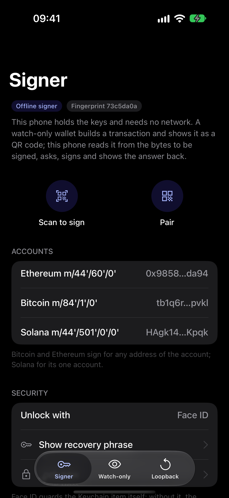
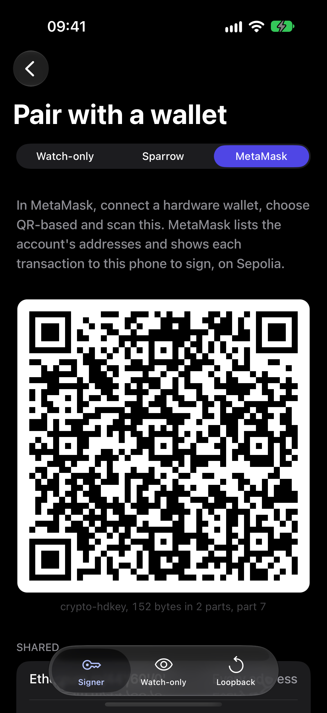
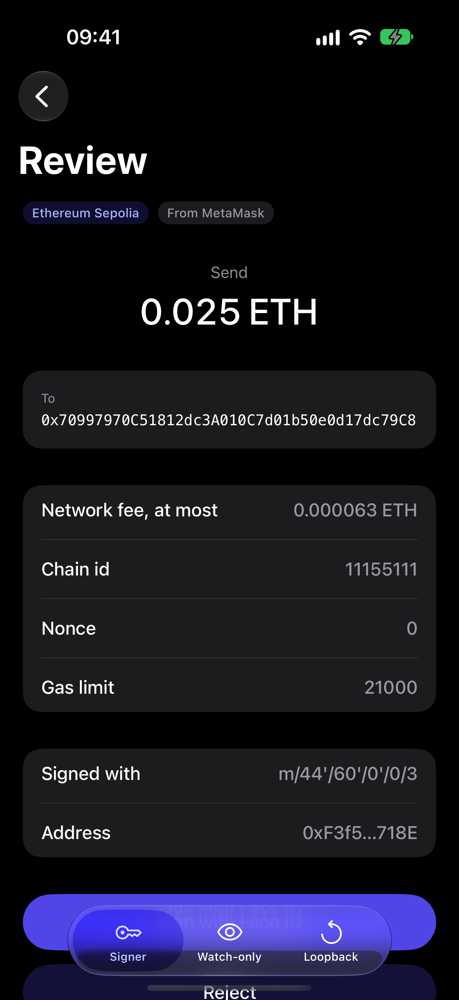
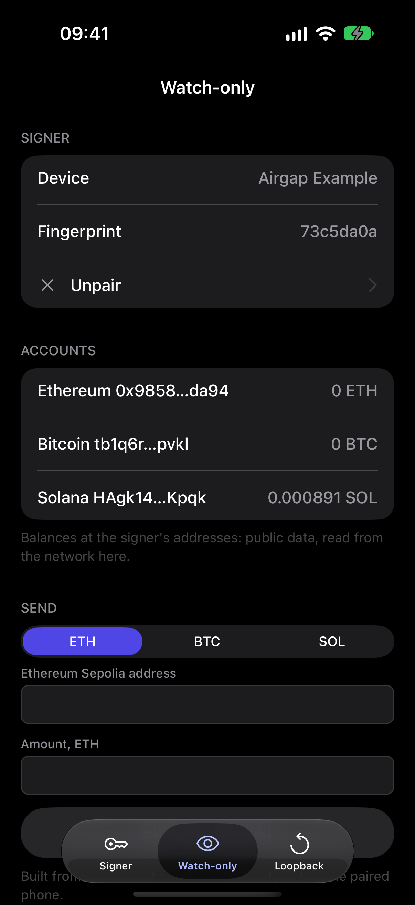

# crypto-airgap

[](https://www.npmjs.com/package/@hzblj/crypto-airgap)
[](./LICENSE)

Air-gapped signing for React Native and Expo, as data. A watch-only wallet and an offline signer (a hardware wallet,
or a second phone that never goes online) exchange requests, accounts and signatures as QR codes: Uniform Resources
(BC-UR v2) with fountain-coded multipart parts, typed and bounded decoding, and every answer checked against its
question. Headless: no UI, no camera, no QR rendering. The keys, the signing and the verification are
[`@hzblj/nitro-crypto`](https://github.com/hzblj/nitro-crypto)'s engine.

<p>
  
  
  
  
</p>

| Package | What it is |
| --- | --- |
| [`@hzblj/crypto-airgap`](./packages/crypto-airgap/README.md) | The protocol: Bytewords, deterministic CBOR, fountain-coded multipart, a typed registry, the public key types (`crypto-hdkey`, `crypto-multi-accounts`, …). No dependencies; installs alone. |
| [`@hzblj/crypto-airgap-bitcoin`](./packages/crypto-airgap-bitcoin/README.md) | PSBTs as `crypto-psbt` both ways, accounts as `crypto-account` (Sparrow's pairing), signing for any address of an account. |
| [`@hzblj/crypto-airgap-ethereum`](./packages/crypto-airgap-ethereum/README.md) | ERC-4527's `eth-sign-request` and `eth-signature`, accounts as `crypto-hdkey` (MetaMask's QR hardware wallets). |
| [`@hzblj/crypto-airgap-solana`](./packages/crypto-airgap-solana/README.md) | `sol-sign-request` and `sol-signature`, for transactions and messages. |

```sh
npx expo install @hzblj/crypto-airgap @hzblj/crypto-airgap-ethereum @hzblj/crypto-ethereum @hzblj/nitro-crypto react-native-nitro-modules
```

```ts
import {createMultipartDecoder, createMultipartEncoder, createRequestId} from '@hzblj/crypto-airgap'
import {ethereumAirgap} from '@hzblj/crypto-airgap-ethereum'

const airgap = ethereumAirgap(crypto.chains.ethereum)
const request = {account, requestId: createRequestId(crypto.random), transaction}
const {sha256} = crypto.hash // the engine's: the protocol package has no hash of its own
const sender = createMultipartEncoder(airgap.encodeSignRequest(request), {sha256}) // the app shows sender.nextPart()

const receiver = createMultipartDecoder({allowedTypes: airgap.responseTypes, sha256}) // the app feeds it what it scans
const answer = airgap.decodeSignResponse(receiver.result(), {request}) // its signer recovered and checked
if (answer.kind === 'transaction') await rpc('eth_sendRawTransaction', [answer.transaction.serialized])
```

The signer's side reads a request for its own accounts (any address of an account, as Sparrow and MetaMask ask),
shows it, and signs once the user agrees:

```ts
const request = airgap.decodeSignRequest(scanned, {fingerprint: wallet.fingerprint, accountPath: "m/44'/60'/0'"})
if (await userConfirms(request)) {
  show(airgap.encodeSignResponse(await airgap.signRequest(request, path => wallet.deriveAccount({chain: 'ethereum', path}))))
}
```

## The example

`apps/example` is an Expo app with three tabs, on Sepolia, Bitcoin testnet4 and Solana devnet:

- **Signer**: this phone as the offline signer. A recovery phrase in the Keychain behind Face ID, pairing codes for
  another phone's Watch-only tab, Sparrow or MetaMask, and Scan to sign: a request read from the bytes to be signed,
  signed after Face ID, the answer shown back. It talks to no network.
- **Watch-only**: this phone as the online side. Pair with a signer (another phone's Signer tab, or the accounts a
  Keystone or OneKey shows), see the balances, build a payment, show it as a request, scan the signature, check it
  and broadcast it.
- **Loopback**: both sides on one phone with a demo key, through the same encoders and decoders and a pretend camera
  that misses every third code.

## This repository

| Path | What lives there |
| --- | --- |
| `packages/crypto-airgap/`, `crypto-airgap-bitcoin/`, `-ethereum/`, `-solana/` | The packages, each published on its own |
| `apps/example/` | The example app (private), and its Maestro flows in `e2e/` |
| `scripts/` | The pack check, version sync |
| `docs/` | [Compatibility](./docs/compatibility.md) (what was tested against what), [decisions](./docs/adr) |

```sh
yarn                 # install
yarn test            # every package's tests, on the engine compiled to WebAssembly
yarn typecheck       # tsc
yarn lint            # Biome
yarn pack:check      # what npm receives, and a consumer type-check
yarn ios             # the example on the iOS simulator (yarn android for Android)
yarn example e2e ios # Maestro: the flows on the booted simulator, Metro running
```

## More libraries

The other libraries from the same author are at **[libraries.janblazej.dev](https://www.libraries.janblazej.dev)**.

[Security](./SECURITY.md) · [MIT](./LICENSE)
